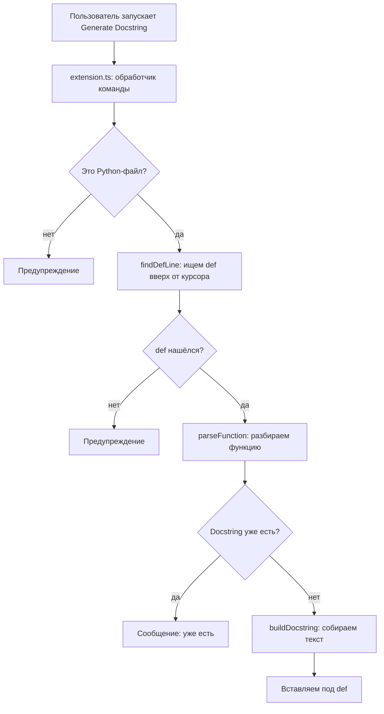
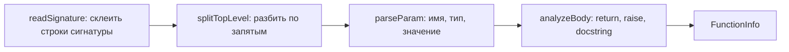

# Документация: Docstring Generator

## 1. Техническое задание

**Цель.** Плагин для VS Code, который сам делает заготовку docstring для функции на Python.

**Что плагин должен делать**

1. Есть команда «Generate Docstring» в палитре команд.
2. Команда работает только в Python-файлах. В остальных показывает предупреждение.
3. Функцию ищет по курсору: курсор на строке `def` или ниже, в теле функции.
4. Разбирает сигнатуру: имя, параметры, типы, значения по умолчанию, `*args`, `**kwargs`, тип возврата. Сигнатура может быть в несколько строк.
5. Пропускает `self` и `cls`.
6. Смотрит тело функции: есть ли `return` со значением и есть ли `raise`.
7. Вставляет docstring под сигнатурой с правильным отступом.
8. Если docstring уже есть, второй не вставляет.

**Требования**

- Работает без интернета и без сторонних библиотек.
- Не трогает остальной код.

**Ограничения**

- Тип возврата берётся только из `->`.
- Функции в одну строку не поддерживаются.
- Вложенные функции учитываются вместе с внешней.
- Описания пользователь пишет сам.

## 2. Как устроен плагин

Плагин состоит из двух частей. В `package.json` объявлена команда `docgen.generate`. В `extension.ts` функция `activate` подключает к ней обработчик. Когда пользователь запускает команду, VS Code вызывает этот обработчик.

Сама логика разбора лежит в `parser.ts`. Этот файл ничего не знает про VS Code: ему передают массив строк файла, а он возвращает результат.

Как проходит одна команда:

Что происходит внутри `parseFunction`:

## 3. Структуры данных

**Param** — один параметр функции.

| Поле | Тип | Что это |
|---|---|---|
| `name` | `string` | имя параметра (у `*args` со звёздочкой) |
| `type` | `string?` | тип, если указан |
| `defaultValue` | `string?` | значение по умолчанию, если есть |

**FunctionInfo** — всё, что плагин узнал о функции.

| Поле | Тип | Что это |
|---|---|---|
| `name` | `string` | имя функции |
| `params` | `Param[]` | массив параметров без `self` и `cls` |
| `returnType` | `string?` | тип из `->` |
| `hasReturn` | `boolean` | есть ли `return` со значением |
| `raises` | `string[]` | названия исключений из `raise` |
| `indent` | `string` | отступ у строки `def` |
| `signatureEnd` | `number` | номер последней строки сигнатуры |
| `hasDocstring` | `boolean` | есть ли уже docstring |

## 4. Функции

### src/parser.ts

| Функция | Что делает |
|---|---|
| `findDefLine(lines, cursor)` | Идёт от курсора вверх и возвращает номер первой строки с `def`. Если не нашла, возвращает -1 |
| `readSignature(lines, start)` | Склеивает строки сигнатуры, пока все скобки не закроются |
| `splitTopLevel(text)` | Режет текст по запятым, но не там, где запятая внутри скобок или кавычек |
| `parseParam(raw)` | Разбирает один параметр вида `name: type = default`. Для `self`, `cls`, `/` и `*` возвращает `null` |
| `analyzeBody(lines, signatureEnd, defIndent)` | Читает тело функции по отступам, ищет `return`, `raise` и готовый docstring |
| `parseFunction(lines, defLine)` | Собирает всё это в `FunctionInfo` |
| `buildDocstring(info)` | Делает из `FunctionInfo` строки docstring |

### src/extension.ts

| Функция | Что делает |
|---|---|
| `activate(context)` | Регистрирует команду `docgen.generate` и выполняет весь сценарий |
| `deactivate()` | Вызывается при выключении плагина. Ничего не делает |

## 5. Проверка

Проверял руками на файле `examples/test.py`.

| Что проверяю | Что должно получиться |
|---|---|
| Простая функция `area(a, b, c)` | параметры, возвращаемое значение и пример вызова |
| Метод с `self`, типами, значением по умолчанию, `*args` и `raise` | `self` пропущен, типы и исключение есть |
| Сигнатура в несколько строк со строкой `"x, y"` | значение не разрезано по запятой |
| Функция, у которой уже есть docstring | сообщение, ничего не вставляется |
| Файл не Python | предупреждение |
| Курсор выше любой функции | предупреждение |